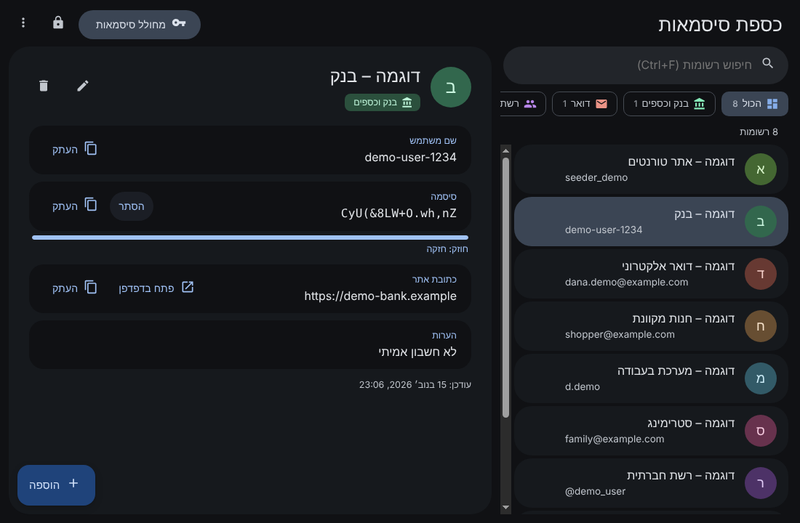
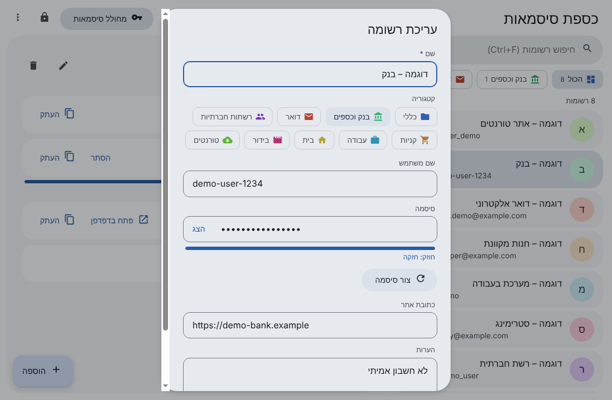
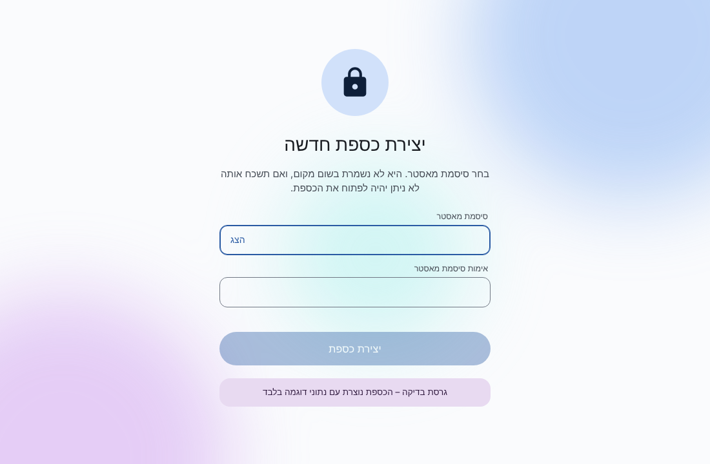
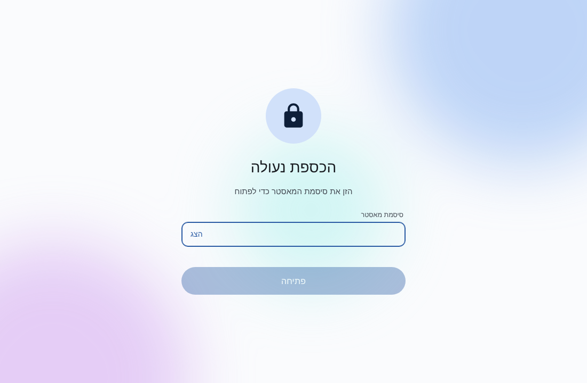
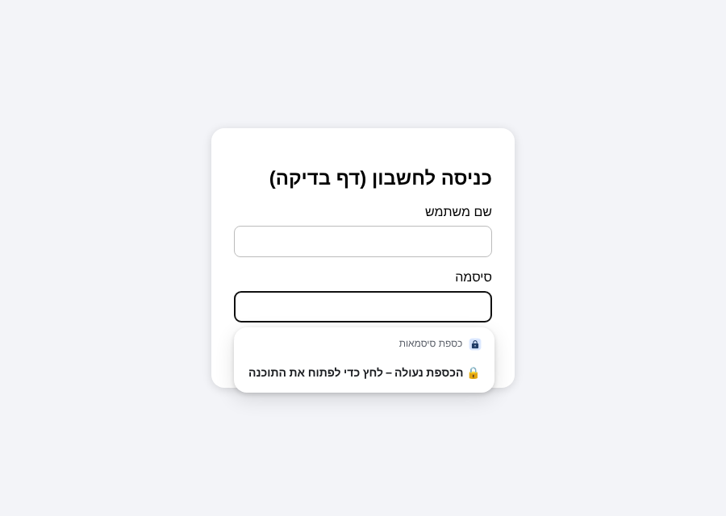

<div dir="rtl">

# 🔐 כספת סיסמאות

מנהל סיסמאות לאנדרואיד ול-Windows. הממשק בעברית, מימין לשמאל, בעיצוב **Material You**.
הכספת מוצפנת ונשמרת רק במכשיר שלך: אין שרת, אין ענן, ואין חשבון.

> ⚠️ **גרסת בדיקה.** הכספת נוצרת עם **נתוני דוגמה בלבד** (חשבונות מומצאים בדומיינים מסוג `.example`). עדיין לא עברה ביקורת אבטחה חיצונית.

## ⬇️ הורדה

את הגרסה האחרונה מורידים מ-**[Releases](https://github.com/e844/password-vault/releases/latest)**:

| מכשיר | קובץ | התקנה |
|---|---|---|
| 🤖 אנדרואיד 8 ומעלה | `PasswordVault-Android.apk` | פותחים את הקובץ בטלפון ומאשרים "התקנה ממקור זה". אם Play Protect מזהיר, בוחרים "התקנה בכל זאת". |
| 🪟 Windows 10/11 | `PasswordVault-Windows.zip` | קליק ימני ← **חלץ הכול**, ואז מפעילים את `PasswordVault.exe`. אם SmartScreen מזהיר, לוחצים **More info** ← **Run anyway**. |

בשתי האפליקציות יש כפתור **בדיקת עדכונים** בתפריט ⋮, והוא מחובר לעמוד ה-Releases.

---

## 🖥️ גרסת Windows

<p align="center">
  
  
</p>

**מה יש בה:**
- **רשומות:** הוספה, עריכה, מחיקה וחיפוש (Ctrl+F).
- **9 קטגוריות לפי נושא:** בנק, דואר, רשתות חברתיות, קניות, עבודה, בית, בידור, טורנטים וכללי. לכל קטגוריה צבע ואייקון, ואפשר לסנן לפיהן.
- **מחולל סיסמאות:** אורך 8–64, בחירת סוגי תווים ומד חוזק.
- **פתיחת אתר בדפדפן** ישירות מהרשומה.
- **ייבוא וייצוא CSV** מ-Chrome, Edge, Firefox וביטוורדן. הקטגוריה מזוהה אוטומטית לפי האתר.
- **גיבוי מוצפן ושחזור.** הגיבוי הוא אותו קובץ בטלפון ובמחשב, אז אפשר להעביר אותו ביניהם.
- **החלפת סיסמת מאסטר.**
- **נעילה אוטומטית:** אחרי 15 דקות כברירת מחדל, ואפשר לשנות. הכספת ננעלת תמיד בנעילת המחשב, במעבר לשינה ובסגירת התוכנה.
- **עיצוב:** הצבעים נלקחים מצבע ההדגשה של Windows, מצב כהה עובר אוטומטית, והאנימציות רצות על ה-GPU.

<p align="center">
  
  
</p>
<p align="center">
  
  
</p>

### 🌐 מילוי אוטומטי באתרים (Chrome / Edge / Brave)

תוסף קטן לדפדפן ממלא שם משתמש וסיסמה מתוך התוכנה. הוא מדבר **רק עם התוכנה במחשב**, דרך Native Messaging ובלי אינטרנט. הוא ממלא **רק באתר שהכתובת שלו תואמת לרשומה**, כך שאתר מתחזה לא יקבל את הסיסמה.

<p align="center">
  
  
  
</p>

**התקנה:**
1. בתוכנה, פתח את התפריט ⋮ ← **מילוי אוטומטי בדפדפן** ← **פתח את תיקיית התוסף**.
2. בדפדפן, פתח את `chrome://extensions` (ב-Edge: `edge://extensions`) והפעל **Developer mode** (מצב מפתח).
3. לחץ **Load unpacked** (טען פריט לא ארוז) ובחר את התיקייה `browser-extension`.
4. כשתיכנס לשדה התחברות באתר, תופיע רשימה קטנה מתחת לשדה. הכספת צריכה להיות פתוחה בתוכנה.

---

## 📱 גרסת אנדרואיד

<!-- ANDROID_SCREENSHOTS -->

**מה יש בה:** כל מה שיש במחשב (קטגוריות, מחולל, ייבוא וייצוא, גיבוי ושחזור, החלפת סיסמת מאסטר, נעילה אוטומטית), ובנוסף:
- **מילוי אוטומטי באפליקציות ובאתרים.** האפליקציה נרשמת כשירות המילוי האוטומטי של אנדרואיד. מפעילים אותה מהתפריט ⋮ ← **הפעלת מילוי אוטומטי**, ובוחרים "כספת סיסמאות". ב-Chrome צריך גם להפעיל בהגדרות: *Autofill services* ← *Autofill using another service*.
  - כשהכספת נעולה, ההצעה היא "פתח את הכספת", ונפתח מסך עם סיסמת מאסטר ובחירת רשומה.
  - באתרים, ההתאמה היא לפי הדומיין בלבד. באפליקציות, היא לפי שם החבילה.
- **Material You:** צבעים מהטפט (אנדרואיד 12 ומעלה), מצב כהה, ואייקון שמשתנה לפי ערכת הנושא.
- **חסימת צילומי מסך,** וגם הסתרה במסך "אפליקציות אחרונות".
- **נעילה מיידית** כשהמסך כבה.
- **בלי הרשאת אינטרנט בכלל.** כפתור העדכונים פותח את דף ה-Releases בדפדפן.

> 💡 **לפני עדכון באנדרואיד:** צור גיבוי מוצפן. בגרסת הבדיקה כל בנייה חתומה במפתח אחר, ולכן צריך להסיר את הגרסה הקודמת לפני ההתקנה, וההסרה מוחקת את הכספת. אחרי ההתקנה משחזרים מהגיבוי.

---

## 🔒 אבטחה

| | |
|---|---|
| הצפנה | **AES-256-GCM** (הצפנה מאומתת: סיסמה שגויה או קובץ ששונה מתגלים) |
| גזירת מפתח | **PBKDF2-HMAC-SHA256**, 600,000 חזרות (ההמלצה של OWASP), מלח אקראי |
| ספריות | רק ספריות ההצפנה המובנות: JCA באנדרואיד, ו-OpenSSL של Node במחשב. אין מימוש הצפנה עצמי |
| סיסמת מאסטר | לא נשמרת בשום מקום, גם לא hash שלה. הבדיקה היא הצלחת הפענוח |
| זיכרון | המפתח קיים רק בזמן שהכספת פתוחה, ונמחק בנעילה |
| לוגים | אין כתיבה ללוג. בדיקה אוטומטית סורקת את הקוד ומוודאת את זה |
| רשת | אנדרואיד: בלי הרשאת אינטרנט. מחשב: כל בקשות הרשת של הממשק חסומות. יוצאת מהכלל רק בדיקת העדכונים, שמתבצעת רק כשלוחצים עליה, מול api.github.com |
| לוח העתקה | מתנקה אחרי 30 שניות ובכל נעילה |
| ניסיונות שגויים | אחרי 5 ניסיונות יש השהיה שהולכת וגדלה |

**מגבלות ידועות:**
- **שדות טקסט:** בזמן ההקלדה הסיסמה נשמרת כמחרוזת בזיכרון, ואי אפשר למחוק אותה ידנית.
- **השהיה אחרי ניסיונות שגויים:** מתאפסת כשמפעילים את התוכנה מחדש.
- **קובץ CSV מיוצא:** לא מוצפן, ותופיע אזהרה לפני הייצוא.

## 🧪 בדיקות

כל דחיפה ל-`main` מריצה ב-GitHub Actions את הבדיקות האלה ובונה את שתי האפליקציות:

| בדיקות | מה נבדק |
|---|---|
| Android, יחידה | הצפנה, כספת, CSV, גיבוי, התאמת אתרים, ותאימות לקובץ שנוצר במחשב |
| Windows, יחידה | הצפנה, כספת, CSV, גיבוי, גשר הדפדפן ו-native host, ובדיקת עדכונים |
| Android, ממשק | הפעלה אמיתית על אמולטור דרך המסכים, כולל צילומי המסך שבעמוד הזה |
| Windows, קצה לקצה | מעבר על כל התהליכים בממשק (`npm run test:e2e`), וכן בדיקת מילוי אמיתית ב-Chromium עם התוסף |

## 📁 מבנה

```
android/     אפליקציית אנדרואיד (Kotlin, Jetpack Compose, Material 3)
desktop/     אפליקציית Windows (Electron)
  browser-extension/   התוסף לדפדפן
docs/        צילומי מסך
```

</div>
